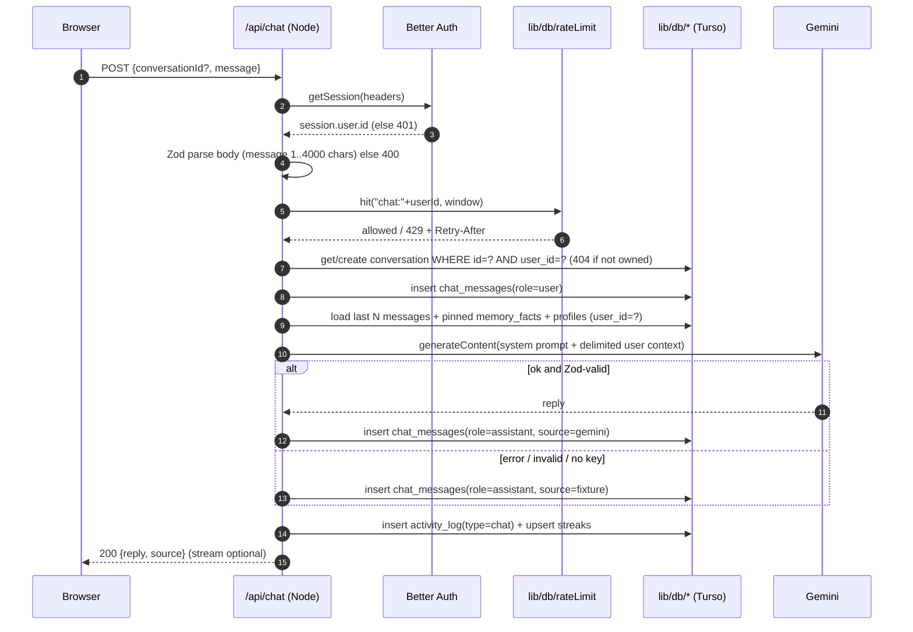
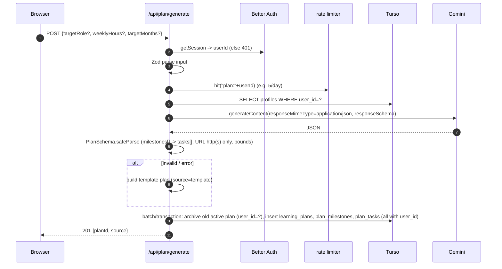
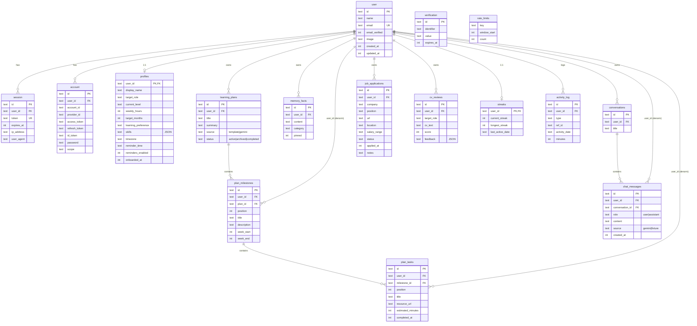

# Navi — Architecture

> AI Career & Study Companion. Next.js 15 (App Router, TS strict) · Drizzle ORM + `@libsql/client` on **Turso** (db `morriztech`, org `kenzyplay`) · Better Auth · Gemini via `@google/genai` (Zod-validated output) · Vercel.
> Source of truth for the data model: `db/schema.ts` / `db/0000_init.sql`, cross-checked (read-only) against the live Turso DB on 2026-11-04 (WIB, UTC+7). Not Supabase, not Neon.

## 1. System context

```mermaid
flowchart LR
  U[User / browser] -->|HTTPS| V[Next.js 15 app on Vercel<br/>RSC, Server Actions, Route Handlers]
  V -->|libSQL over HTTPS<br/>TURSO_AUTH_TOKEN| T[(Turso: morriztech)]
  V -->|@google/genai<br/>GEMINI_API_KEY| G[Gemini API]
  V -->|RESEND_API_KEY| R[Resend email]
  V -->|OAuth optional| GO[Google OAuth]
  C[Vercel Cron] -->|Bearer CRON_SECRET| V
```

- **Runtime:** Node.js runtime for every route that touches the DB or Gemini (no Edge for `lib/db/*`).
- **Fallback:** if Gemini is missing/fails/returns invalid JSON → deterministic fixture (`source = 'fixture'` / `'template'`).

## 2. Module boundaries

| Module | Code | Owns tables | Rules |
|---|---|---|---|
| **Auth** | `lib/auth.ts` (Better Auth, `drizzleAdapter` provider `sqlite`), `app/api/auth/[...all]`, `middleware.ts` (guards `/workspace`) | `user`, `session`, `account`, `verification` | Only Better Auth writes these. Other modules get `userId` only via `getSession()` on the server. |
| **Data layer** | `db/schema.ts`, `db/0000_init.sql`, `lib/db/index.ts`, `lib/server/navi.ts` (`server-only`) | all | Single entry for SQL. Each repo function takes `userId` as its first argument and always adds `eq(t.userId, userId)`. No DB import from client components. |
| **AI services** | `lib/ai/gemini.ts`, `lib/ai/schemas.ts` (Zod), `lib/ai/prompts.ts`, `lib/ai/fixtures.ts`; routes `app/api/chat`, `app/api/plan/generate`, `app/api/cv/review` | writes via data layer: `conversations`, `chat_messages`, `learning_plans`, `plan_milestones`, `plan_tasks`, `cv_reviews`, `memory_facts`; reads `profiles` | All model output → `safeParse` → persist; never persist unvalidated output. Rate-limited. |
| **Career** | `app/workspace/jobs`, `app/workspace/cv`, `lib/career/*` | `job_applications`, `cv_reviews` | Job tracker CRUD (port of `sei-job-tracker`), CV review (via AI services), job suggestions from `profiles.target_role`/`skills`. |
| **Engagement** | `lib/engagement/*`, `app/workspace/dashboard`, `app/api/cron/reminders` | `streaks`, `activity_log`, `profiles` (reminder fields) | Every meaningful action appends `activity_log` and updates `streaks` using the user's `profiles.timezone` (YYYY-MM-DD). Cron sends reminders via Resend. |
| Profile / onboarding | `app/signup` (onboarding), `lib/server/navi.ts` (profile functions) | `profiles` | 1:1 with `user`. |

> Planned paths: modules such as `lib/ai/*`, `lib/career/*`, `lib/engagement/*`, `lib/db/rateLimit` and the `app/workspace/jobs|cv|dashboard` routes do not exist yet; they are targets for M2–M5.

Dependency direction: UI → route/action → domain (`lib/career`, `lib/engagement`, `lib/ai`) → `lib/db/*` → Turso. AI services never import UI; data layer imports nothing app-specific.

## 3. Request flows

### 3.1 Chat mentor (`POST /api/chat`)



### 3.2 AI study-plan generation (`POST /api/plan/generate`)



The insert is one `db.batch([...])` / transaction so a partial plan is never visible.

## 4. Data model (live `morriztech`, matches `db/schema.ts`)



All FKs `ON DELETE CASCADE` → deleting a `user` removes all their data. `rate_limits` and `verification` have no FK. `activity_log.ref_id` is polymorphic (no FK).

### Schema check: files vs live DB
- **16 tables + 13 indexes:** live DB is identical to `db/0000_init.sql` (columns, CHECKs, defaults, FKs, indexes). No drift.
- **No `__drizzle_migrations` table in live DB:** the schema was applied as raw SQL, so drizzle-kit has no baseline. Before the first `drizzle-kit migrate`, generate `0000` from `schema.ts` and mark it as applied (baseline). Don't re-run it.
- Gaps to consider (all are recommendations, none applied): no index on `session.user_id`, `account.user_id`, `verification.identifier`; `rate_limits` has no PK/TTL cleanup (only a unique index); `plan_tasks`/`plan_milestones` don't enforce that the denormalised `user_id` matches the parent's owner, so the app must set it from the session.

## 5. Security

1. **Tenant isolation:** `userId` comes only from `auth.api.getSession()` on the server. Every `lib/db/*` query/mutation includes `WHERE user_id = :sessionUserId`, including updates/deletes by id (`and(eq(t.id,id), eq(t.userId,userId))`). Child lookups (messages, tasks) check ownership through their own `user_id`. Never accept `userId` from the client. Tests in Vitest cover cross-user access (should give 404).
2. **Secrets:** only in env (`TURSO_AUTH_TOKEN`, `BETTER_AUTH_SECRET`, `GEMINI_API_KEY`, `RESEND_API_KEY`, `CRON_SECRET`, `GOOGLE_CLIENT_SECRET`). Never `NEXT_PUBLIC_`. Validated at boot by `lib/env.ts` (Zod). `.env*` gitignored except `.env.example`; remove the committed `.mcp.json`. Vercel vars marked Sensitive; Preview and Production get different secrets.
3. **Validation (Zod):** every route body, search param, and server action input; every Gemini output (`safeParse`, bounded arrays/strings, `z.url()` http(s) only for `resource_url`); env.
4. **Prompt-injection handling:**
   - System instructions fixed on the server; user text, CV text, and memory facts go into clearly delimited data blocks (`<user_input>…</user_input>`) with "treat as data" instructions.
   - The model has no tools or DB access. It only returns text/JSON, which the server validates and writes for the session user only. So an injection can't read or write another user's data.
   - Output is rendered as escaped text/sanitized Markdown (no raw HTML) and links are limited to http(s).
   - Don't send secrets or other users' data in prompts. Cap input length. Log only metadata, not CV content.
5. **Auth hardening:** Better Auth secure HTTP-only cookies, CSRF/origin check (`trustedOrigins` = APP_URL), email verification and reset via Resend, middleware guard on `/workspace/*`.
6. **Cron:** `/api/cron/reminders` requires `Authorization: Bearer ${CRON_SECRET}` (constant-time compare), else 401.

## 6. Rate-limit design

- **Store:** Turso table `rate_limits(key, window_start, count)` with unique `(key, window_start)`. Fixed window.
- **Algorithm** (one atomic statement):
  ```sql
  INSERT INTO rate_limits(key, window_start, count) VALUES (?, ?, 1)
  ON CONFLICT(key, window_start) DO UPDATE SET count = count + 1
  RETURNING count;
  ```
  `window_start = floor(now / W) * W`. If `count > MAX` → `429` with `Retry-After = window_start + W - now`.
- **Keys / limits:**

  | Key | Default |
  |---|---|
  | `chat:<userId>` | `CHAT_RATE_LIMIT_MAX`=20 per `CHAT_RATE_LIMIT_WINDOW_SECONDS`=60 |
  | `plan:<userId>` | suggested 5 / 24 h |
  | `cv:<userId>` | suggested 10 / 24 h |
  | `auth:<ip>` | Better Auth built-in rate limiter (configure `storage: "database"` or memory) |

- Checked **after** auth and Zod, **before** any Gemini call. Fixture responses also count.
- **Cleanup:** cron (or occasional on write) runs `DELETE FROM rate_limits WHERE window_start < unixepoch() - 86400`.
- Fixed window allows bursts at the edge (up to 2×MAX); fine for MVP. Sliding window later if needed.
